

  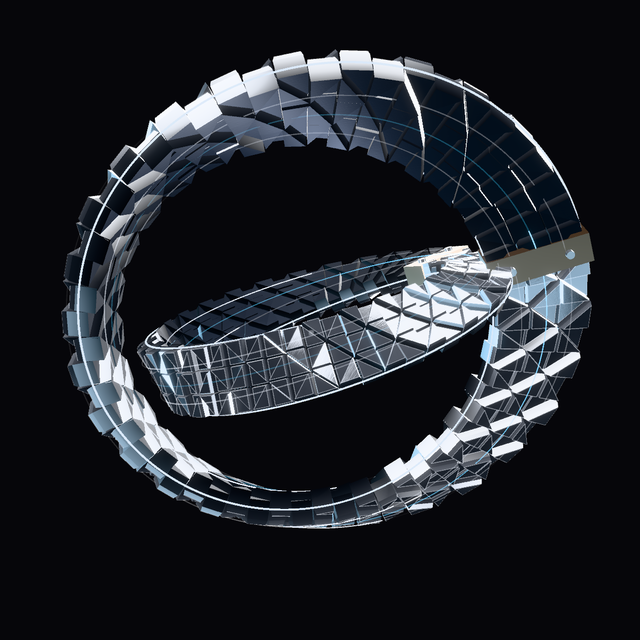

<h1 align="center">JARVIS</h1>

<b>A personal AI for a Windows PC: it understands rough, typo-filled sentences, does the work, talks back in a dry Tony Stark voice, and asks before it touches anything that matters.</b>

> **This is a showcase. The source code is private, and every piece of data you see is demo data.** Nothing here comes from a real inbox, calendar, contact list or file.

## Watch it

[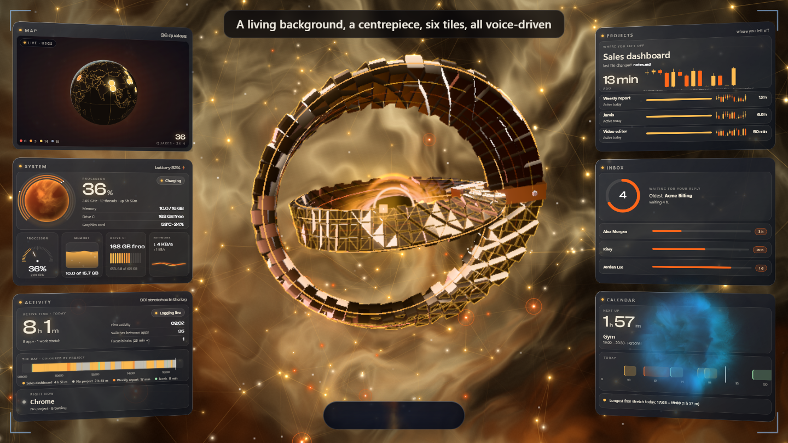](video/jarvis-tour.mp4)

**A 7-minute tour** of the real app running on demo data, narrated by Jarvis in his own voice. Click the picture to play it.

- [**The journey**](docs/JOURNEY.md): how a notes folder became a PC assistant with a face, mistakes included
- [**Every feature**](docs/FEATURES.md): screen by screen, with what works, what is new and what does not exist yet

## Screenshots

<table>
<tr><td width="50%" valign="top">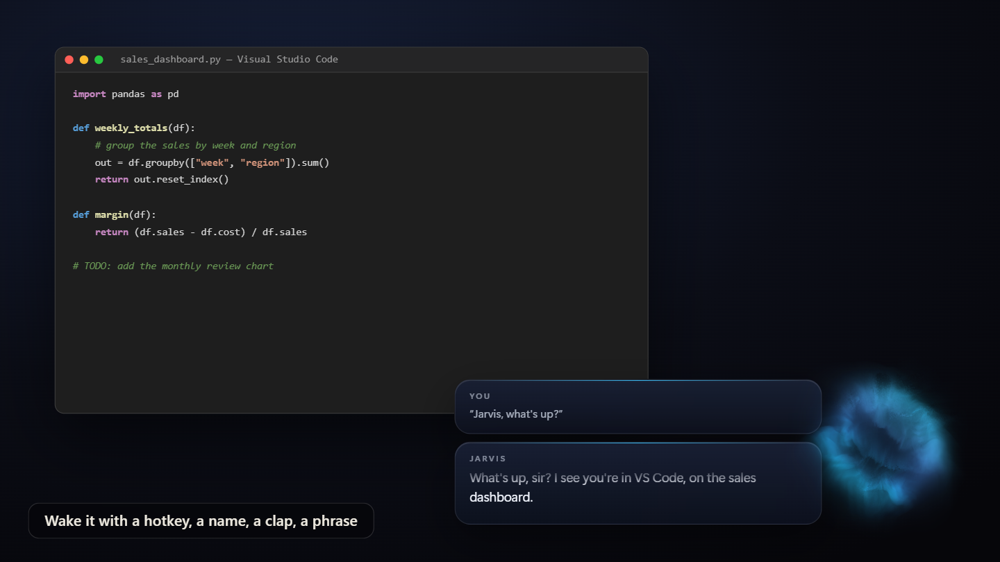 <b>Meet the orb: it forms on a wake, and the cards show what you said and what Jarvis says</b></td><td width="50%" valign="top">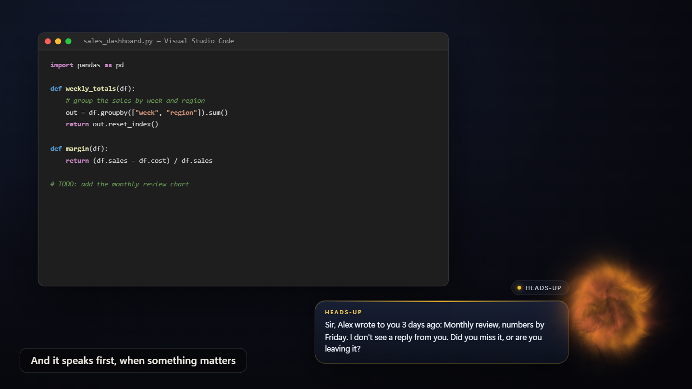 <b>It speaks first: a mail waiting three days, said once, never nagging</b></td></tr>
<tr><td width="50%" valign="top"> <b>The Workshop: a living background, a centrepiece and six glass tiles</b></td><td width="50%" valign="top">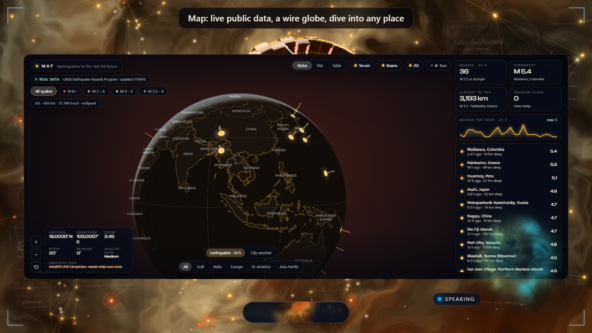 <b>The map tile, enlarged: a wire globe on live public data</b></td></tr>
<tr><td width="50%" valign="top">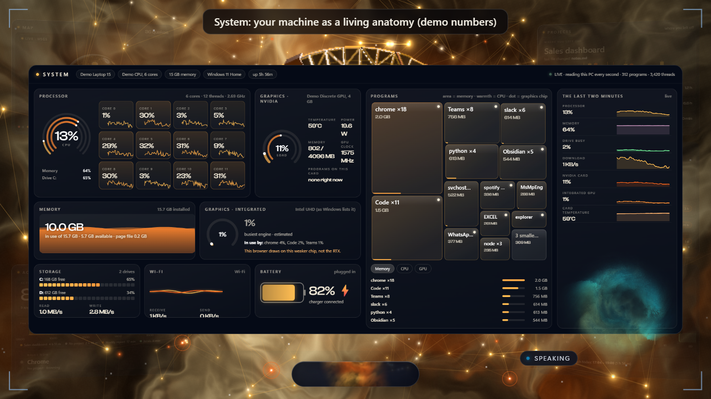 <b>The system tile: your machine as a living anatomy (demo numbers)</b></td><td width="50%" valign="top">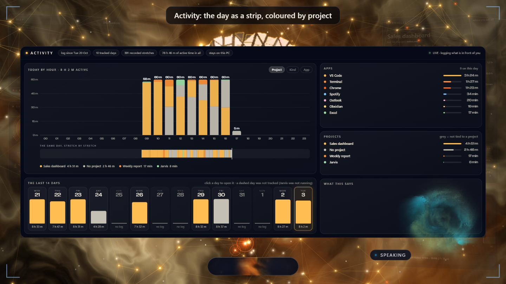 <b>The activity tile: the day by project, from an on-PC log</b></td></tr>
<tr><td width="50%" valign="top">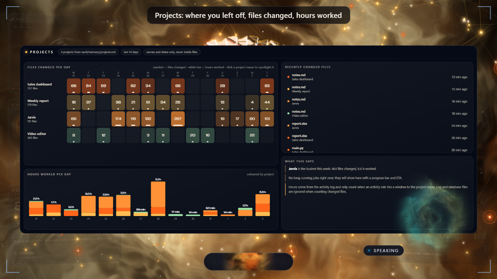 <b>The projects tile: where you left off, files changed, hours worked</b></td><td width="50%" valign="top">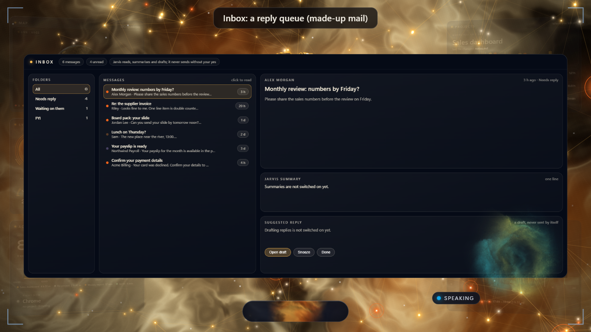 <b>The inbox tile: a reply queue built from made-up mail</b></td></tr>
<tr><td width="50%" valign="top">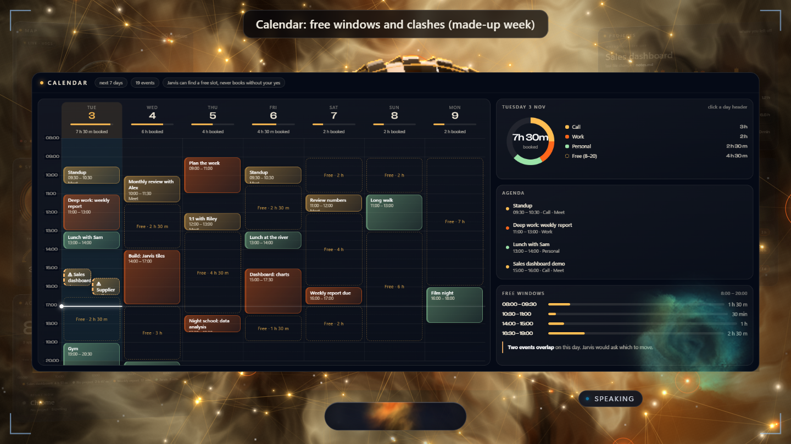 <b>The calendar tile: free windows and clashes across a made-up week</b></td><td width="50%" valign="top">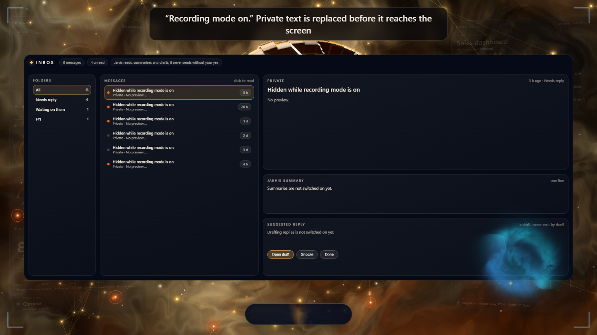 <b>Recording mode: private text is replaced before it reaches the screen</b></td></tr>
<tr><td width="50%" valign="top">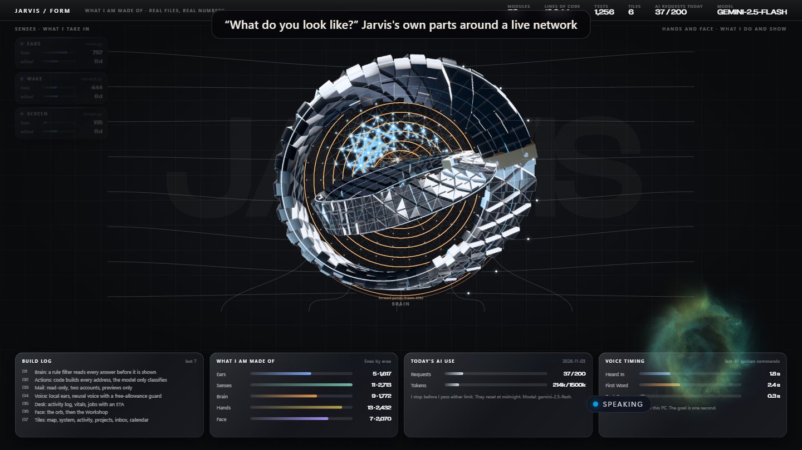 <b>The “what do you look like” page: Jarvis's own parts around a live network</b></td><td width="50%" valign="top">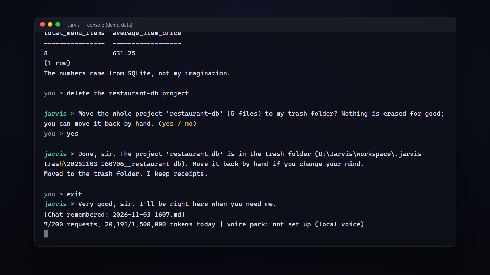 <b>Create: a plan first, nothing written before you say yes</b></td></tr>
<tr><td width="50%" valign="top">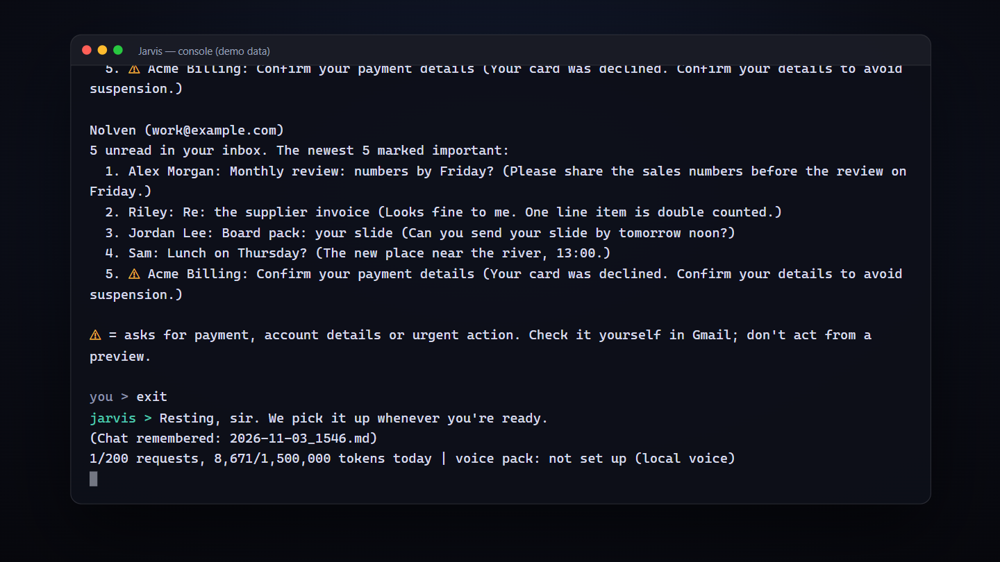 <b>Mail, read-only: previews on screen, a warning on a message that asks for money</b></td><td width="50%" valign="top">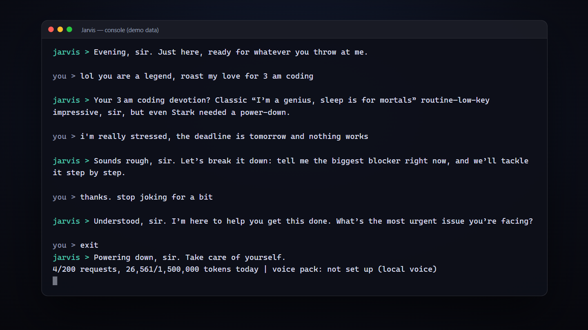 <b>A voice with moods: playful when you are, calm and serious when you are stressed</b></td></tr>
</table>

## How it fits together

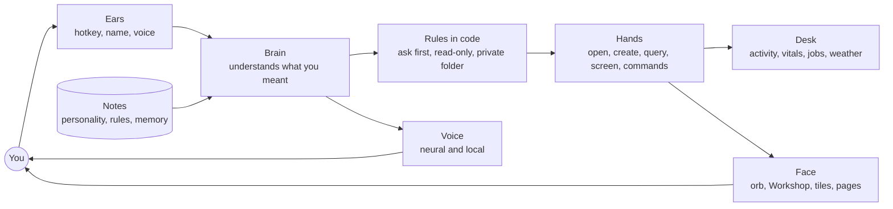

## Facts

| | |
|---|---|
| Platform | Windows 10 and 11 |
| Built | One small task a day, from 2 October 2026 |
| Automated tests | 1,256, offline, about a minute |
| Modules | 58, one per ability |
| Lines of Python | 12,948 |
| The face | A transparent orb, then the Workshop: 6 glass tiles and 4 pages, all voice-driven |
| Memory | A folder of plain notes you can read and correct |
| Cost | Free tiers only |
| Status | Working. The backend is done; changes are normal work |

---

Copyright (c) 2026 Khushal Vashistha. All rights reserved. Showcase only: the source code is private and no licence is granted.
